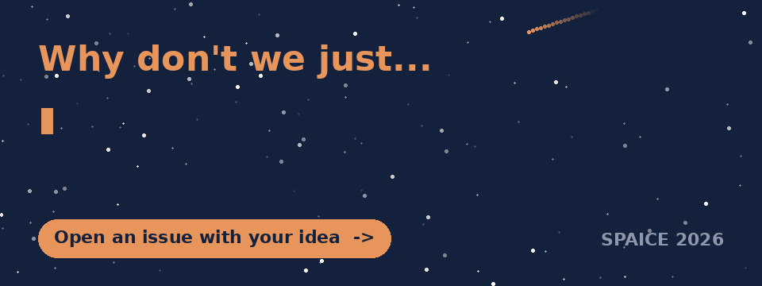

  

<h1 align="center">Too Useful Not to Build</h1>

<b>The software we always wanted and never wrote</b>

  
  
  
  

---

Writing software just got cheap. Tools the space and AI community shelved for lack of funding are now a week's work, sometimes an afternoon's.

**So what should we build?** Every idea here is a GitHub issue. Open one, vote on others, and say if you'd help.

## 🚀 Three steps

1. **[Pick a category and finish the sentence](https://github.com/gomezzz/too-useful-not-to-build/issues/new/choose)** "Why don't we just…"
2. **Vote** with a 👍 reaction on every idea you would actually use. Ideas are ranked by 👍.
3. **Comment** with references, data, or "I'd build this".

   
  Scan to add an idea from your phone

## 🧭 Categories

| | Category | What belongs here | Start |
|---|---|---|---|
| 🛟 | **Rescue** | Port, test or document legacy code | [New idea](https://github.com/gomezzz/too-useful-not-to-build/issues/new?template=1-rescue.yml) |
| 🏗️ | **Infrastructure** | Benchmarks, loaders, converters, simulators | [New idea](https://github.com/gomezzz/too-useful-not-to-build/issues/new?template=2-infrastructure.yml) |
| 🎓 | **Teaching** | Interactive papers, tutorials, outreach | [New idea](https://github.com/gomezzz/too-useful-not-to-build/issues/new?template=3-teaching.yml) |
| 🌉 | **Bridges** | A tool another field already has | [New idea](https://github.com/gomezzz/too-useful-not-to-build/issues/new?template=4-bridges.yml) |
| 🌌 | **Moonshots** | Research nobody could staff before | [New idea](https://github.com/gomezzz/too-useful-not-to-build/issues/new?template=5-moonshots.yml) |

## 🏷️ Labels

- **Category** (set automatically by the form): `cat: rescue`, `cat: infrastructure`, `cat: teaching`, `cat: bridges`, `cat: moonshots`
- **Domain** (added by maintainers from your answer): `astronomy`, `earth observation`, `planetary`, `heliophysics`, `onboard`, `mission ops`, `education`, `cross-domain`
- **Status:** `needs champion`, `has champion`, `in progress`, `exists already`

## 💡 Why now?

- One developer rebuilt seven Adobe apps and three Office apps as open-source Rust in a few weeks with LLM agents ([PetaPixel](https://petapixel.com/2026/10/07/someone-rebuilt-free-open-source-versions-of-photoshop-premiere-and-lightroom-using-ai/), [TechSpot](https://www.techspot.com/news/114179-developer-who-cloned-photoshop-using-ai-has-now.html)).
- Bun moved from Zig to Rust in 11 days, a port its author estimated at a team-year ([The Decoder](https://the-decoder.com/bun-ditches-zig-for-rust-with-help-from-claude-fable-5-writes-over-a-million-lines-of-code-in-11-days/)).
- [Tau Ceti](https://github.com/TauCetiProject/TauCeti) builds a mathematics library where humans write roadmaps and review rubrics, and AI writes and reviews the code.

Cheap code is the easy half. The ideas, the specifications and the validation still have to come from people who know the science. That's you.

---

Started at the SPAICE 2026 unconference, ESA ESTEC, Noordwijk. Ideas are welcome from anyone, at any time.

